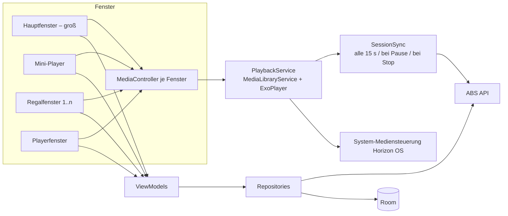

# ShelfVR – Audiobookshelf-Player für Meta Quest

> **Ideen- und Spezifikationsdokument für Coding-Agenten**
> Stand: 30.10.2026 (Rev. 2: Stufe 2 auf anheftbare Fenster umgestellt) · Owner: Lorenz · Status: *Konzept freigegeben, Implementierung noch nicht begonnen*
> Arbeitstitel „ShelfVR“: Name und Package-ID sind noch offen (siehe §13).

---

## 0. Wie dieses Dokument zu benutzen ist

Dieses Dokument ist die **einzige verbindliche Grundlage** für die Implementierung. Es beschreibt Ziele, getroffene Entscheidungen, Architektur, Anforderungen und Risiken.

**Regeln für den Coding-Agenten**

1. **Bei Architekturentscheidungen und Funktionsabwägungen immer erst Lorenz fragen.** Das gilt für alles, was nicht in §4 (ADRs) entschieden ist und nicht trivial rückbaubar ist: neue Libraries mit großem Footprint, Modulschnitt, Datenmodell-Änderungen, Scope-Erweiterungen und UX-Grundsatzfragen. Kleine, lokal rückbaubare Implementierungsdetails darfst du selbst entscheiden. Dokumentiere sie kurz im PR bzw. Commit.
2. **ABS-Management-Funktionen sind out of scope.** Dazu zählen Metadaten bearbeiten, Uploads, Re-Encoding, Scans, Backups, User-Verwaltung und Server-Settings. Baue keine Endpunkte davon ein, auch nicht „nebenbei“.
3. **Quest 2 ist die Referenz-Hardware.** Jede Funktion muss auf einer Quest 2 laufen und dort getestet werden. Quest 3/3S-exklusive Features sind nur als optionale Verbesserung zulässig.
4. **Die ABS-API-Doku (api.audiobookshelf.org) ist veraltet.** Maßgeblich sind der Quellcode des ABS-Servers (`advplyr/audiobookshelf`) und reales Verhalten gegen einen Testserver. Bei Unklarheit: Server-Code lesen, nicht raten.
5. **Lizenzhygiene:** Code aus **Lissen** (MIT) darf übernommen werden, mit Erhalt des Copyright-Hinweises in `THIRD_PARTY_NOTICES.md`. Code aus der **offiziellen ABS-App** (GPL-3.0) darf **nicht kopiert** werden, nur als Verhaltensreferenz gelesen.
6. **Keine Secrets in Logs.** Access-/Refresh-Tokens, Passwörter und Server-URLs mit Credentials werden nie geloggt.
7. Erweiterungspunkte aus §11 **nicht implementieren, aber architektonisch offenhalten.** Interfaces und Abstraktionen dafür sind erwünscht, Features nicht.
8. **Fensterplatzierung gehört dem System.** Die App kann Fenster öffnen, aber nicht selbst an Wände heften oder positionieren. Jede Fensterart muss für sich allein funktionieren und darf nicht davon abhängen, wo andere Fenster stehen.

---

## 1. Vision & Ziele

Ein nativer Audiobookshelf-Client (ABS) für Meta Quest in zwei Stufen:

| Stufe | Inhalt | Ziel |
|---|---|---|
| **1 – MVP** | Klassische 2D-App als Horizon-OS-Fenster mit großem Modus und kompakter **Mini-Player-Leiste** | Hörbücher im Alltag in VR/MR nebenbei hören, auch während andere Apps laufen |
| **2 – Ausbaustufe „Wand-Fenster“** | Aus der normalen UI lassen sich zwei zusätzliche Fensterarten öffnen: **Regalfenster** (eine ABS-Bibliothek als Plattenregal, blätter- und sortierbar) und **Playerfenster** (Plattenspieler-Optik). Der Nutzer heftet sie mit der System-Funktion an die Wände des Quest-Lofts oder im Passthrough an echte Wände. | Bibliothek als „Einrichtung“ im eigenen virtuellen oder echten Raum: Platte im Regal antippen, auf dem Plattenspieler läuft das Hörbuch |
| *(Option, nicht geplant)* | Immersiver 3D-Modus mit greifbaren Platten (Spatial SDK) | Nur falls die Fenster-Lösung an Grenzen stößt; siehe ADR-003 |

**Nicht-Ziele**

- ABS-Administration und -Management (siehe §0 Regel 2)
- eBook-Reader
- Eigener Server oder Proxy; die App spricht direkt mit ABS
- Eigene 3D-Umgebung bzw. Nachbau des Lofts
- Social-Features, Multi-User-Sessions in VR

---

## 2. Machbarkeitsbewertung

| Baustein | Bewertung | Begründung |
|---|---|---|
| 2D-App auf Quest | 🟢 machbar | Horizon OS basiert auf AOSP. Android-Apps laufen als frei positionierbare, skalierbare 2D-Panels. |
| Hintergrund-Audio | 🟢 machbar | Offiziell unterstützt über Media3 `MediaSession` + `MediaSessionService` (Foreground-Service). Die System-Mediensteuerung erscheint, wenn die App im Hintergrund ist. |
| ABS-Anbindung | 🟢 machbar, 🟡 Doku-Risiko | Die REST-API ist vollständig vorhanden, die Doku aber veraltet. Seit ABS v2.26 gilt JWT-Auth mit Refresh-Token (§6). |
| Mehrere Fenster einer App | 🟢 machbar | Mehrere Activities in eigenen Panels sind ein Standard-Feature (`FLAG_ACTIVITY_LAUNCH_ADJACENT` + `NEW_TASK` + `MULTIPLE_TASK`), Default-Größe per Manifest. Grundlage für Mini-Player, Regal- und Playerfenster. |
| Mini-Player-Leiste | 🟡 machbar, Details offen | Wie klein Horizon OS ein Fenster zulässt, muss ein Spike klären (S-2). |
| Fenster an Wände heften | 🟡 machbar, aber vom System gesteuert und im Wandel | Seit Horizon OS v81 können Nutzer 2D-Fenster per „Anker“ im Loft (Immersive Home) und im Passthrough anheften. Die Anker überleben einen Neustart. **Grenzen:** bis zu drei Anker pro Modus (Loft bzw. Passthrough), und es gibt keine Entwickler-API. In der aktuellen Testversion (PTC, Okt. 2026) ersetzt Meta den Anker durch „Magnetismus“ an Oberflächen. Die Details können sich also noch ändern (§10, RI-02). |
| Räumlicher Klang | 🟢 wahrscheinlich, 🟡 Details offen | Horizon OS gibt den Ton von 2D-Fenstern räumlich an der Fensterposition wieder (von Lorenz beim Quest-Browser beobachtet). Die App muss dafür nichts tun. Offen ist, **welchem Fenster** das System den Ton zuordnet, wenn eine App mehrere Fenster hat und der Ton aus einem Hintergrund-Service kommt. Das klärt Spike S-4. |
| Regal-Optik im Fenster | 🟢 machbar | Reine Compose-UI. Ob das Fenster einen transparenten Hintergrund haben kann (Regal „hängt“ ohne Rahmen an der Wand), prüft S-5. |

**Gesamtfazit:** Das Projekt ist auf Quest 2 umsetzbar, und die Fenster-Lösung für Stufe 2 ist **deutlich einfacher** als ein eigener 3D-Loft: kein Spatial SDK, keine 3D-Assets, kein Performance-Budget für eine Szene. Räumlichen Klang liefert das System gleich mit, weil Horizon OS den Ton von 2D-Fenstern an deren Position wiedergibt. Der Preis: Platzierung, Anzahl der angehefteten Fenster und die Zuordnung des Tons zu einem Fenster liegen beim System statt bei der App. Diese Punkte klären die Spikes in Phase 0, bevor Features gebaut werden.

---

## 3. Rahmenbedingungen

### 3.1 Zielhardware & OS

- **Minimum:** Meta Quest 2 (Snapdragon XR2). Quest 3/3S/Pro sollen ebenfalls laufen.
- **Speicher:** Das PSS-Kill-Limit liegt bei **4,4 GiB auf Quest 2/Pro** und 5,75 GiB auf Quest 3/3S. Ziel ist deutlich darunter.
- **Fenster-Anker (Stufe 2)** setzen Horizon OS **v81+** voraus. Für den MVP reicht jede aktuelle Version.
- **Lebenszyklus Quest 2:** Feature-Updates bis Ende 2026, danach nur noch kritische und Sicherheitsupdates (bis ca. Ende 2027). **Konsequenz:** Das OS der Quest 2 friert ein. Die Fensterverwaltung der Quest 2 bleibt dann auf dem Stand ihres letzten Feature-Updates, während Quest 3/3S neuere Varianten (z. B. Magnetismus statt Anker) bekommen. Stufe 2 muss mit beiden Varianten zurechtkommen. Die minimal unterstützte Horizon-OS-Version wird im README festgehalten.
- **Eingabe:** Controller-Ray, Hand-Tracking (Pinch), optional Bluetooth-Tastatur/-Maus. B/Y wirken als Android-Back. Es gibt **keine Back-Geste bei Hand-Tracking**, daher braucht jeder Screen einen sichtbaren Zurück-Button.

### 3.2 Server & Netzwerk

- **Annahme:** Der ABS-Server ist von der Quest **direkt über eine IP-Adresse oder eine Domain** erreichbar. VPN-/Tailnet-Szenarien muss die App nicht berücksichtigen.
- **Referenz-Setup (Lorenz):** Die Quest wird im Heimnetz genutzt; ABS ist dort über eine **SSL-geschützte Domain** (gültiges Zertifikat) erreichbar.
- **Konsequenzen:**
  - `https://<domain>` ist der Normalfall. `http://<ip>:<port>` im LAN muss ebenfalls funktionieren; Cleartext dafür nur per explizitem Opt-in in der `network_security_config`, nicht global.
  - Die Server-URL wird normalisiert (Schema ergänzen, Trailing Slash, Port, Subpfad-Deployments wie `https://host/audiobookshelf`).
- **Mindest-ABS-Version:** 2.26 (JWT-Auth). **Empfohlen ≥ 2.36**, weil vorher ein Auth-Fehler (CVE-2026-73085) Refresh-Tokens auf API-Endpunkten akzeptierte. Bei älteren Servern zeigt die App einen Hinweis.

### 3.3 Distribution (Annahme, noch zu bestätigen)

- **Primär:** private Nutzung per **Sideload** (Developer Mode, ADB/SideQuest).
- **Nichts verbauen, was eine spätere Store-Veröffentlichung verhindert.** Hinweis: Meta verlangt für Streaming-/Medien-Apps im Store einen Login, der ohne Tastatur auskommt (Device Code, QR oder Companion-App). ABS bietet das nativ nicht. Das wäre bei Store-Ambitionen ein eigenes Thema (§13).

---

## 4. Getroffene Entscheidungen (ADRs)

### ADR-001 – Tech-Stack: Kotlin + Android (Jetpack Compose, Media3) ✅ entschieden, in Rev. 2 angepasst

- **Beide Stufen** sind reine Android-Apps mit mehreren Panel-Activities. Ein Codebase, ein APK, ein Player-Service.
- **Meta Spatial SDK wird nicht mehr benötigt** (Folge von ADR-003). Es bleibt nur als Option für einen späteren immersiven Modus im Hinterkopf. Die Architektur soll einen solchen Modus nicht verbauen, aber auch nichts dafür vorbereiten, was Aufwand kostet.
- *Verworfen:* Unity (2D-Panel-App, Hintergrund-Audio und Mini-Player umständlich), WebXR/PWA (schwaches Hintergrund-Audio).

### ADR-002 – Code-Basis: Neuaufbau, Lissen als MIT-Referenz ✅ entschieden

- Neues Projekt mit eigenem Modulschnitt (§5).
- **Lissen** (`GrakovNe/lissen-android`, MIT) darf als Referenz und Code-Spender dienen, z. B. für API-Modelle, Session-Sync-Logik und Media3-Setup. Übernommener Code bekommt einen Header-Kommentar mit Herkunft und wird in `THIRD_PARTY_NOTICES.md` aufgeführt.
- Die offizielle ABS-App (GPL-3.0) dient nur als Verhaltensreferenz, kein Code-Transfer.

### ADR-003 – Stufe 2: anheftbare Regal- und Playerfenster statt eigenem 3D-Loft ✅ entschieden (Rev. 2, ersetzt „eigener virtueller Loft“)

- Stufe 2 nutzt den **System-Loft** (bzw. Passthrough) und die System-Funktion zum Anheften von Fenstern.
- Die normale UI kann zwei zusätzliche Fensterarten öffnen: **Regalfenster** und **Playerfenster** (§9).
- **Begründung:** viel weniger Aufwand und Risiko (kein Spatial SDK, keine 3D-Assets, kein Szenen-Performance-Budget), funktioniert im Loft **und** im Passthrough ohne Zusatzarbeit, nutzt die echte Quest-Umgebung statt eines Nachbaus.
- **Akzeptierte Einschränkungen:** keine greifbaren 3D-Platten; Platzierung, Anzahl der Anker und die Zuordnung des räumlichen Klangs zu einem Fenster liegen beim System; die Fensterverwaltung von Horizon OS ändert sich gerade (§10).
- *Verworfen:* eigener virtueller Loft mit Spatial SDK (Rev. 1). Kann als immersiver Modus später wieder aufgegriffen werden, falls nötig.

### ADR-004 – MVP-Scope & Erweiterbarkeit ✅ entschieden

- MVP = Mindestliste aus §7.
- **Nicht im MVP, aber architektonisch vorbereitet:** Sleep-Timer, Lesezeichen, Browsing nach Serien/Autoren/Sammlungen/Playlists, Podcasts und Offline-Downloads (§11). Ziel: Diese Features später ohne größere Refactorings ergänzen.

### ADR-005 – Bibliotheken (Vorschlag, gilt als Default bis Widerspruch)

| Zweck | Wahl | Begründung |
|---|---|---|
| UI | Jetpack Compose (Material 3 als Basis; **Horizon OS UI Set** im Spike S-1 evaluieren) | Eine UI-Technologie für alle Fensterarten |
| Player | Media3 ExoPlayer + `MediaLibraryService` | `MediaLibraryService` statt `MediaSessionService`, damit später Browsing-Bäume (Podcasts, Downloads) ohne Umbau möglich sind |
| HTTP | OkHttp + Retrofit + kotlinx.serialization | OkHttp wird von Media3 (`OkHttpDataSource`) für authentifiziertes Streaming geteilt: ein Auth-Interceptor für API und Audio |
| DI | Hilt | Standard, gut mit ViewModels und Services |
| Persistenz | Room (Cache, Regal-Konfiguration, später Downloads), DataStore (Settings) | Room-Schema von Anfang an mit Migrationen |
| Secrets | Android Keystore + verschlüsselter Speicher (Tink oder EncryptedDataStore) | Tokens nie im Klartext |
| Bilder | Coil | Cover-Caching, Größensteuerung; wichtig, wenn mehrere Regalfenster gleichzeitig offen sind |
| Echtzeit (optional, später) | Socket.IO-Client | Live-Fortschritt anderer Geräte; nicht im MVP |

---

## 5. Architektur

### 5.1 Modulschnitt

```
:app                       Application, Navigation, DI-Root, Manifest (alle Fenster-Activities)
:core:model                Reine Kotlin-Domänenmodelle (LibraryItem, Chapter, PlaybackState, …)
:core:network              ABS-API-Client (Retrofit/OkHttp), Auth-Interceptor, Token-Refresh
:core:database             Room: Server/Accounts, Cache, ShelfConfig, (später) Downloads
:core:datastore            Settings (Skip-Intervalle, Default-Speed, UI-Modus …)
:core:designsystem         Compose-Theme, VR-taugliche Komponenten (große Hit-Targets)
:domain                    Use-Cases & Repository-Interfaces (plattformunabhängig)
:data                      Repository-Implementierungen (Network + DB + Cache)
:playback                  MediaLibraryService, ExoPlayer, Session-Sync, Kapitel-Logik
:feature:onboarding        Server einrichten, Login
:feature:library           Bibliotheksauswahl, Item-Grid, Suche, Item-Details
:feature:player            Großer Player, Kapitelübersicht
:feature:miniplayer        Kompakte Player-Leiste
:feature:shelfwindow       (Stufe 2) Regalfenster
:feature:playerwindow      (Stufe 2) Playerfenster in Plattenspieler-Optik
```

**Grundsätze**

- **`:playback` ist die Single Source of Truth für den Wiedergabezustand.** Alle Fenster (groß, Mini-Player, Regal, Playerfenster, System-Mediensteuerung) sind nur Views auf die `MediaController`-Verbindung. Daraus folgt: Fenster öffnen oder schließen unterbricht die Wiedergabe nie, und alle Fenster zeigen stets denselben Zustand.
- **Jedes Fenster ist eigenständig.** Es baut seine eigene `MediaController`-Verbindung auf, lädt seine Konfiguration selbst (z. B. Regal-ID) und funktioniert, auch wenn die Hauptapp geschlossen ist. Das ist nötig, weil Horizon OS angeheftete Fenster nach einem Neustart einzeln wiederherstellt.
- Fensterübergreifende Zustände (aktive Bibliothek, Regal-Konfiguration, Login) kommen aus Room/DataStore als Flows, nicht aus In-Memory-Singletons einzelner Activities.
- `:domain` kennt Abstraktionen für spätere Erweiterungen (§11), z. B. `Playable` (Book | PodcastEpisode) und `MediaSource` (Remote | Local).

### 5.2 Komponenten-Überblick



### 5.3 Activities & Fensterarten

| Activity | Fenster | Zweck |
|---|---|---|
| `MainActivity` | groß | Onboarding, Bibliothek, Suche, Player, Kapitel, Einstellungen; von hier werden Regal- und Playerfenster geöffnet |
| `MiniPlayerActivity` | klein | Kompakte Leiste, je nach Ergebnis von S-2 (§7.6) |
| `ShelfWindowActivity` | mittel, mehrfach | Ein Regal = eine Instanz, identifiziert über `shelfId` (§9.2) |
| `PlayerWindowActivity` | mittel | Plattenspieler-Ansicht (§9.3). *Ob Mini-Player und Playerfenster eine Activity mit zwei Layouts werden, entscheidet sich nach S-2 (§13).* |

Fenster werden mit `FLAG_ACTIVITY_LAUNCH_ADJACENT | FLAG_ACTIVITY_NEW_TASK | FLAG_ACTIVITY_MULTIPLE_TASK` gestartet und bekommen per Manifest-`<layout>` passende Default-Größen.

---

## 6. Audiobookshelf-Integration

> ⚠️ Pfade und Felder gegen den Server-Quellcode der Zielversion verifizieren (§0 Regel 4). Die Tabelle ist der Startpunkt, nicht die Wahrheit.

### 6.1 Authentifizierung (ABS ≥ 2.26)

1. `POST /login` mit `{username, password}` und Header **`x-return-tokens: true`**. Die Antwort enthält `user.accessToken` und `user.refreshToken`. Das alte Feld `user.token` wird **ignoriert**.
2. API-Requests: `Authorization: Bearer <accessToken>`.
3. Bei **401**: `POST /auth/refresh` mit Header **`x-refresh-token: <refreshToken>`** aufrufen. Die Antwort enthält neue Access- **und** Refresh-Tokens (Rotation). Beide atomar speichern, dann den Original-Request wiederholen. Parallel laufende Requests teilen sich **einen** Refresh-Vorgang (Mutex), damit sich rotierende Refresh-Tokens nicht gegenseitig entwerten. *Wichtig mit mehreren Fenstern:* Der Mutex und der Token-Speicher sind prozessweit (Singleton im DI-Graph), nicht pro Activity.
4. Schlägt der Refresh fehl, geht es zurück zum Login. Gespeicherte Server-URL und Username sind vorausgefüllt. Regal- und Playerfenster zeigen in diesem Fall einen Hinweis mit Button „Anmelden“, der das Hauptfenster öffnet.
5. `POST /logout` mit `x-refresh-token` beim Abmelden.
6. **Vorbereitet, nicht MVP:** OIDC/SSO über `/auth/openid` mit PKCE und Custom-URI-Redirect. Horizon OS unterstützt OAuth-Redirects über Private-Use-URI-Schemes (AppAuth).
7. Server-Defaults für Token-Laufzeiten (Access ca. 1–12 h, Refresh 7–30 Tage, je nach Version und Konfiguration) können zu Re-Logins führen, wenn die App lange nicht genutzt wird. Die UX muss das abfangen (klarer Hinweis statt kryptischem Fehler).

### 6.2 Benötigte Endpunkte (MVP)

| Zweck | Methode & Pfad | Hinweise |
|---|---|---|
| Server-Check | `GET /ping`, `GET /status` | Erreichbarkeit, Init-Status |
| Login / Refresh / Logout | siehe §6.1 | |
| User & Server-Infos | `POST /api/authorize` | Nach App-Start mit gespeichertem Token; liefert u. a. Server-Version |
| Bibliotheken | `GET /api/libraries` | Filter auf `mediaType == book` im MVP; Podcast-Bibliotheken ausgegraut („bald“) |
| Items einer Bibliothek | `GET /api/libraries/{id}/items?limit&page&sort&desc&filter&minified=1` | Paging (Paging 3); `sort` z. B. `media.metadata.title`, `media.metadata.authorNameLF`, `addedAt`, `media.metadata.publishedYear`, `media.duration`. Basis für Item-Grid **und** Regalfenster |
| Suche | `GET /api/libraries/{id}/search?q=&limit=` | Liefert Books, Authors, Series, Tags. MVP zeigt Books; Rest vorbereitet |
| Item-Details | `GET /api/items/{id}?expanded=1&include=progress` | Kapitel, Tracks, Dauer, Fortschritt |
| Cover | `GET /api/items/{id}/cover` (Größen-/Format-Parameter verifizieren) | Kleine Varianten für Grid und Regal anfordern |
| Wiedergabe starten | `POST /api/items/{id}/play` | Body: `deviceInfo` (clientName, clientVersion, deviceId, manufacturer, model, sdkVersion), `mediaPlayer`, `supportedMimeTypes`, `forceDirectPlay`, `forceTranscode`. Antwort: **PlaybackSession** mit `audioTracks[]` (`contentUrl`, `startOffset`, `duration`), `chapters`, `currentTime` |
| Session-Sync | `POST /api/session/{sessionId}/sync` | `{currentTime, timeListened, duration}` |
| Session schließen | `POST /api/session/{sessionId}/close` | Mit finalem Sync-Body |
| Fortschritt (Fallback) | `GET/PATCH /api/me/progress/{libraryItemId}` | Zum Lesen beim Öffnen und für „als beendet markieren“ |

### 6.3 Wiedergabe-Logik

- **Multi-Track-Bücher:** Ein Buch kann aus vielen Dateien bestehen. Jeder `audioTrack` wird ein Media3-`MediaItem`. Die Playlist im Player entspricht den Tracks. Die App rechnet zwischen **Buchzeit** (global, wie ABS sie speichert) und **Track-Position** um (`startOffset`). Seek, Kapitel und Fortschritt arbeiten immer in Buchzeit.
- **Kapitel** stammen aus `chapters[]` (Buchzeit `start`/`end`). Kapitelgrenzen können Track-Grenzen überschreiten.
- **Streaming-URLs:** `contentUrl` ist relativ zur Server-URL. Auth läuft per Header über die geteilte OkHttp-Instanz (`OkHttpDataSource`), **nicht** per Token im Query-String.
- **Direct Play vs. Transcode:** `supportedMimeTypes` ehrlich angeben (MediaCodec-Abfrage auf dem Gerät: mp3, aac/m4a/m4b, opus, flac, ogg …). Für nicht unterstützte Formate liefert ABS einen HLS-Stream. ExoPlayer braucht deshalb das HLS-Modul.
- **Sync-Strategie:** während der Wiedergabe alle **15 s** (konfigurierbar), sofort bei Pause, Seek-Ende, Kapitelsprung und App-Stop. `timeListened` ist die real gehörte Zeit seit dem letzten Sync, **ohne** Seek-Sprünge und **skaliert mit der Wiedergabegeschwindigkeit** (verifizieren, wie ABS es erwartet). Offline-Fehler werden gepuffert und nachgereicht.
- **Resume:** beim Öffnen die Position aus der PlaybackSession bzw. dem Progress übernehmen. Ist der lokale Stand neuer (letzter Sync fehlgeschlagen), gewinnt der neuere Zeitstempel.

---

## 7. Funktionale Anforderungen – MVP (Stufe 1)

Jede Anforderung hat eine ID. Commits und Tests referenzieren sie.

### 7.1 Server einrichten & Login
- **FR-01** Server-URL eingeben, normalisieren, prüfen (`/ping`, `/status`) und eine verständliche Fehlermeldung zeigen (DNS, TLS, Timeout, kein ABS).
- **FR-02** Login mit Username/Passwort nach §6.1. Tokens verschlüsselt speichern.
- **FR-03** Automatischer Token-Refresh; bei endgültigem Fehlschlag Re-Login-Dialog mit vorausgefüllten Daten.
- **FR-04** Abmelden (Server-Logout + lokale Tokens löschen).
- **FR-05** Datenmodell erlaubt **mehrere Server/Accounts**; die UI zeigt im MVP genau einen.
- **FR-06** Server-Version prüfen; Warnung unter 2.36, Blockade unter 2.26.

### 7.2 Bibliothek
- **FR-10** Liste der Bibliotheken; Auswahl wird gespeichert und beim nächsten Start wiederhergestellt.
- **FR-11** Item-Grid der gewählten Bibliothek: Cover, Titel, Autor, Fortschrittsbalken; Paging.
- **FR-12** Sortierung (Titel, Autor, Hinzugefügt, Erscheinungsjahr, Dauer) und Richtung umschaltbar und persistiert. *Die Sortierlogik liegt in `:domain`, weil die Regalfenster in Stufe 2 sie wiederverwenden.*
- **FR-13** Item-Detailansicht: Cover, Metadaten, Beschreibung, Dauer, Fortschritt, Kapitelliste, „Abspielen/Fortsetzen“.

### 7.3 Suche
- **FR-20** Volltextsuche in der aktiven Bibliothek mit Debounce (≥ 300 ms); Ergebnisliste mit Cover.
- **FR-21** Eingabe funktioniert mit der Systemtastatur der Quest. Mindestens 2 Zeichen.

### 7.4 Wiedergabe & Player-Funktionen
- **FR-30** Streaming nach §6.3 inkl. Multi-Track, HLS-Fallback und Resume.
- **FR-31** Play/Pause, Stop (Session schließen).
- **FR-32** Vor/Zurück-Springen um **n Sekunden**; n getrennt für vor/zurück einstellbar (Default 30/15 s).
- **FR-33** Nächstes/vorheriges Kapitel. „Vorheriges“ springt zum Kapitelanfang, wenn man mehr als 3 s im Kapitel ist, sonst zum vorherigen Kapitel.
- **FR-34** Seekbar mit Kapitelzeit (primär) und Buchzeit (sekundär). Restzeit von Kapitel und Buch, jeweils angepasst an die Geschwindigkeit.
- **FR-35** Wiedergabegeschwindigkeit 0,5×–3,0× in 0,05er-Schritten plus Presets (1,0 / 1,25 / 1,5 / 2,0); pro Buch gemerkt, Default global einstellbar.
- **FR-36** Lautstärke: In-App-Regler (Player-Gain 0–100 %), unabhängig von der Systemlautstärke; persistiert.
- **FR-37** Hintergrundwiedergabe über `MediaLibraryService` mit System-Mediensteuerung von Horizon OS (Play/Pause, Skip, Metadaten, Cover).
- **FR-38** Audio-Focus korrekt behandeln (andere Medien-Apps pausieren uns und umgekehrt).
- **FR-39** Fortschrittssync nach §6.3; Offline-Puffer mit späterem Nachsenden.

### 7.5 Kapitelübersicht
- **FR-40** Liste aller Kapitel mit Titel, Startzeit und Dauer; aktuelles Kapitel hervorgehoben und automatisch sichtbar gescrollt.
- **FR-41** Tippen auf ein Kapitel springt an dessen Anfang.

### 7.6 UI-Modi: großer Modus & Mini-Player
- **FR-50** **Großer Modus:** vollständige App (Bibliothek, Suche, Details, Player, Kapitel).
- **FR-51** **Mini-Player-Leiste:** Cover, Buchtitel, Kapiteltitel, Laufzeitinfos (Position/Restzeit im Kapitel, Fortschritt im Buch), Play/Pause, ±n s, Kapitel vor/zurück. Optional: Geschwindigkeit als kleiner Chip.
- **FR-52** Wechsel groß ↔ mini per Button in beide Richtungen; die Wiedergabe läuft unterbrechungsfrei weiter.
- **FR-53** Der Mini-Player ist im Raum frei positionierbar und bleibt sichtbar, während andere Apps laufen.
- **Umsetzungsoptionen (Spike S-2 entscheidet, Ergebnis Lorenz vorlegen):**
  - **A:** eigene `MiniPlayerActivity` als zweites, kleines Panel (Manifest-`<layout>` mit kleiner Default-Größe); das Hauptfenster wird beim Wechsel geschlossen. *Bevorzugt, weil dieselbe Mehrfenster-Technik wie in Stufe 2.*
  - **B:** dieselbe Activity mit Compose-Layoutwechsel und Fensterverkleinerung, falls Horizon OS programmatisches Resizing erlaubt.
  - **C (Fallback):** großer Modus + System-Mediensteuerung als „Mini-Player“.

### 7.7 Einstellungen
- **FR-60** Skip-Intervalle, Default-Geschwindigkeit, Sync-Intervall, Sprache (DE/EN), Server/Account-Verwaltung, App-Version und ABS-Server-Version.

---

## 8. Nicht-funktionale Anforderungen

| ID | Anforderung |
|---|---|
| NFR-01 | **VR-Lesbarkeit:** Mindest-Schriftgröße und Hit-Targets für Ray/Pinch deutlich größer als auf dem Smartphone (Startwert: ≥ 56 dp Targets, ≥ 16 sp Fließtext). Kontraste für Quest-2-LCD prüfen. Angeheftete Fenster werden oft aus größerer Entfernung betrachtet: Regal- und Playerfenster brauchen eher noch größere Elemente. |
| NFR-02 | **Performance Quest 2:** UI flüssig, auch mit Hauptfenster + 2 Regalfenstern + Playerfenster gleichzeitig. Cover-Cache mit Größenlimit, prozessweit geteilt. |
| NFR-03 | **Speicher:** deutlich unter dem PSS-Limit (Quest 2: 4,4 GiB); Ziel mit allen Fenstern offen < 600 MiB. |
| NFR-04 | **Robustheit:** Netzwerkabbrüche (z. B. WLAN-Wechsel, Standby) führen zu Puffern und Retry, nicht zu Datenverlust. Das gilt besonders für den Fortschritt. Fenster, die nach einem Neustart vom System wiederhergestellt werden, starten ohne Fehler, auch wenn das Netz noch nicht da ist. |
| NFR-05 | **Sicherheit:** Tokens im Keystore-geschützten Speicher; kein Token in URLs oder Logs; TLS-Validierung an. Self-signed Zertifikate nur per explizitem Opt-in. |
| NFR-06 | **Barrierearmut:** Content-Descriptions für alle Controls (wichtig auch für Horizon OS „Look and Pinch“, das Interaktionsziele aus der Accessibility-Info ableitet). |
| NFR-07 | **i18n:** Deutsch und Englisch, alle Strings in Ressourcen. |
| NFR-08 | **Testbarkeit:** `:domain` und `:data` mit Unit-Tests; API-Client gegen aufgezeichnete Fixtures realer ABS-Antworten; UI-Smoke-Tests im Meta Spatial Simulator bzw. Emulator, Abnahme auf echter Quest 2. |
| NFR-09 | **Build:** reproduzierbarer Gradle-Build mit Version Catalog. |

---

## 9. Ausbaustufe 2 – Regal- und Playerfenster zum Anheften

### 9.1 Erlebnis

1. Im Hauptfenster gibt es unter „Raum einrichten“ zwei Aktionen: **„Regalfenster öffnen“** (Bibliothek und Sortierung wählen) und **„Playerfenster öffnen“**.
2. Das neue Fenster erscheint neben dem Hauptfenster. Der Nutzer zieht es an eine Wand im Loft (oder im Passthrough an eine echte Wand) und heftet es mit der System-Funktion an.
3. Das **Regalfenster** zeigt Hörbücher als Schallplatten-Cover in Regalbrettern. Knöpfe am Regal blättern durch die Bibliothek.
4. **Platte antippen** → kurze Detailkarte (Titel, Autor, Dauer, Fortschritt) mit „Auflegen“ → Wiedergabe startet. Das Playerfenster zeigt die Platte auf dem Teller.
5. Die angehefteten Fenster bleiben bei Neustart erhalten (System-Verhalten) und zeigen sofort den aktuellen Stand.
6. Die App erklärt beim ersten Öffnen eines Regal- oder Playerfensters kurz, wie man es anheftet (Onboarding-Hinweis, abschaltbar), weil das System-Funktion ist und nicht App-Funktion.

### 9.2 Regalfenster

- **R-01** Jede ABS-Bibliothek kann durch **ein oder mehrere Regalfenster** dargestellt werden. Jedes Regalfenster hat eine eigene, persistierte Konfiguration (`ShelfConfig`, §9.4).
- **R-02** Jedes Regal hat eine **eigene Sortierung** (Optionen wie FR-12), umstellbar direkt am Regal (kleines Einstellungs-Menü am Fenster) und optional einen Filter (vorbereitet, nicht Pflicht).
- **R-03** **Knöpfe am Regal** blättern seitenweise durch die Bibliothek (vor/zurück, an den Anfang). Pro Seite werden *n* Items angezeigt; *n* ergibt sich aus Fenstergröße und Regal-Layout (z. B. 3 Bretter × 6 Platten). Das entspricht dem API-Paging (`limit`/`page`). Die aktuelle Seite wird gespeichert.
- **R-04** Mehrere Regale derselben Bibliothek zeigen entweder **aufeinanderfolgende Seiten** (Regal 2 setzt Regal 1 fort) oder sind unabhängig. *Offene UX-Frage, bei Umsetzung Lorenz fragen (§13).*
- **R-05** Fortschritt am Cover sichtbar (z. B. Banderole oder Kante), das gerade laufende Buch markiert, beendete Bücher gekennzeichnet.
- **R-06** Größe des Fensters ist vom Nutzer veränderbar; das Regal-Layout passt sich an (mehr oder weniger Platten pro Brett), ohne die gespeicherte Seite unsinnig zu verschieben (Anker ist das erste sichtbare Item).
- **R-07** Optik: Holzregal o. Ä. als Compose-Grafik. **Ziel: transparenter Fensterhintergrund**, damit das Regal ohne Fensterrahmen an der Wand zu hängen scheint, sofern Horizon OS das zulässt (Spike S-5). Fallback: Regal-Hintergrund füllt das Fenster.
- **R-08** Ein Regalfenster ist **ohne Hauptfenster** voll funktionsfähig (Blättern, Sortieren, Auflegen).

### 9.3 Playerfenster

- **P-01** Plattenspieler-Optik: sich drehender Teller mit dem Cover des laufenden Buchs, Tonarm-Position = Buchfortschritt.
- **P-02** Bedienelemente wie im Mini-Player (FR-51): Play/Pause, ±n s, Kapitel vor/zurück, plus Geschwindigkeitsregler (FR-35) und Lautstärkeregler (FR-36) im Plattenspieler-Stil.
- **P-03** Buch- und Kapiteltitel, Laufzeitinfos gut lesbar aus Raumentfernung (NFR-01).
- **P-04** Optional: Kapitelgrenzen als Rillen auf der Platte; Antippen einer Rille springt zum Kapitel.
- **P-05** Leerer Zustand (nichts läuft): leerer Teller mit Hinweis „Platte aus einem Regal auflegen“ und Button zur Bibliothek.
- **P-06** Ein Playerfenster gleichzeitig. Wird es erneut geöffnet, holt die App das bestehende in den Vordergrund.
- **P-07** *Klang:* Horizon OS verortet den Ton eines 2D-Fensters an dessen Position (beim Quest-Browser beobachtet). **Ziel:** Der Ton kommt aus dem Playerfenster, sobald es offen ist, sonst aus dem Mini-Player oder Hauptfenster. Wie das System den Ton bei mehreren Fenstern und Wiedergabe aus dem `PlaybackService` zuordnet und ob die App das beeinflussen kann (z. B. welches Fenster zuletzt fokussiert war, welche Activity/Task die Audio-Session „besitzt“), klärt S-4. Das Ergebnis wird Lorenz vorgelegt, bevor M7 beginnt.

### 9.4 Datenmodell (Room; Entität schon im MVP anlegen)

```kotlin
data class ShelfConfig(
  val id: String,                 // wird als Intent-Extra an ShelfWindowActivity übergeben
  val serverId: String,
  val libraryId: String,
  val title: String?,             // optionaler Name am Regal
  val sortKey: SortKey, val sortDesc: Boolean,
  val filter: String?,            // vorbereitet
  val firstVisibleIndex: Int,     // aktuelle Position (statt Seitennummer, siehe R-06)
  val chainedToShelfId: String?,  // R-04 Variante „fortsetzen“
  val createdAt: Long
)
```

- **Fenster-Identität:** Jede `ShelfWindowActivity`-Instanz bekommt ihre `shelfId` per Intent-Extra. Ob Horizon OS beim Wiederherstellen eines angehefteten Fensters nach Neustart **denselben Intent** (inkl. Extras) liefert, ist zu prüfen (S-5). Fallback: `shelfId` zusätzlich in der Intent-Data-URI (`shelfvr://shelf/{id}`) oder im Task-Bezug speichern.
- Regalfenster schließen löscht die Konfiguration **nicht** sofort; verwaiste Regale lassen sich im Hauptfenster unter „Raum einrichten“ wieder öffnen oder löschen.

### 9.5 Grenzen, die das Design berücksichtigen muss

- **Anzahl angehefteter Fenster:** In Horizon OS v81 bis zu **drei Anker pro Modus** (Loft und Passthrough getrennt). Realistisch heißt das z. B. Playerfenster + zwei Regale je Modus. Die App erzwingt kein Limit, weist aber im Onboarding-Hinweis darauf hin.
- **Keine programmatische Platzierung:** Die App kann Fenster weder an eine Position setzen noch anheften (§0 Regel 8).
- **Wechselnde Fensterverwaltung:** In der aktuellen Testversion ersetzt „Magnetismus“ an Oberflächen den Anker. Die App darf sich auf kein bestimmtes Anheft-Verhalten verlassen; Texte im Onboarding-Hinweis generisch halten („Fenster an die Wand ziehen und dort festmachen“).

---

## 10. Risiken & bekannte Probleme

| ID | Risiko | Wahrscheinlichkeit / Auswirkung | Gegenmaßnahme |
|---|---|---|---|
| RI-01 | **Quest-2-OS friert ein**; Quest 2 und Quest 3/3S haben dauerhaft unterschiedliche Fensterverwaltungen | hoch / mittel | Stufe 2 auf beiden testen; keine Annahmen über Anheft-Mechanik (§9.5) |
| RI-02 | **Fensterverwaltung im Umbau:** Meta ändert Anker, Magnetismus, Anzahl und Persistenz angehefteter Fenster; im neuesten PTC ist der Anker entfernt | hoch / mittel | Konzept funktioniert auch mit „frei hingestellten“ Fenstern; Spike S-5 auf Quest 2 und Quest 3; Release-Notes beobachten |
| RI-03 | **Anzahl angehefteter Fenster** (v81: drei pro Modus) reicht nicht für „mehrere Regale pro Bibliothek“ | mittel / mittel | Große, skalierbare Regalfenster (R-06); Regal kann zwischen Bibliotheken umgeschaltet werden; Option „Regal + Player in einem Fenster“ (§13) |
| RI-04 | **Räumlicher Klang** kommt aus dem falschen Fenster (z. B. Hauptfenster statt Playerfenster) oder ist bei Hintergrund-Wiedergabe gar nicht mehr verortet | mittel / niedrig–mittel | S-4 klärt das System-Verhalten (Fokus, Task, Audio-Session); falls nötig Fensterreihenfolge in der UX lenken; im Extremfall später immersiver Modus als Option (ADR-003) |
| RI-05 | **Fenster-Wiederherstellung nach Neustart** liefert nicht den ursprünglichen Intent → Regal weiß nicht, welche Konfiguration es zeigen soll | mittel / mittel | S-5; Fallback-Identität über Data-URI/Task (§9.4) |
| RI-06 | **ABS-API veraltet dokumentiert**; Felder oder Verhalten ändern sich zwischen Server-Versionen | hoch / mittel | Server-Code als Referenz; Fixtures pro Server-Version; Versionsprüfung FR-06; defensive Deserialisierung (`ignoreUnknownKeys`) |
| RI-07 | **Token-Lebensdauer** führt zu Re-Logins nach längerer Nichtnutzung; mehrere Fenster refreshen gleichzeitig | mittel / niedrig | Prozessweiter Refresh-Mutex; klare Re-Login-UX in allen Fenstern; Hinweis auf `REFRESH_TOKEN_EXPIRY` im README |
| RI-08 | **Netzwerk:** Reverse-Proxy-Eigenheiten (Timeouts, WebSocket-Header, Subpfade) oder selbst signierte Zertifikate bei LAN-Zugriff per IP | niedrig / mittel | Spike S-3 gegen Lorenz' echten Server; klare TLS-Fehlermeldungen; self-signed nur per Opt-in (NFR-05) |
| RI-09 | **Codecs/Multi-Track-Edge-Cases** (exotische Formate, viele Kleinstdateien, Kapitel über Track-Grenzen) | mittel / mittel | Ehrliche `supportedMimeTypes`, HLS-Fallback; Testkorpus mit m4b, Multi-mp3, opus |
| RI-10 | **Texteingabe in VR** (Server-URL, Passwort) ist mühsam | hoch / niedrig | Gute Normalisierung, Paste-Unterstützung, Hinweis auf BT-Tastatur; Kamera/QR auf Quest 2 nicht möglich |
| RI-11 | **Lizenzkontamination** durch GPL-Code der offiziellen App | niedrig / hoch | Regel §0.5; Code-Review-Checkliste |
| RI-12 | **Store-Anforderungen** (Device-Code-Login für Medien-Apps, VRCs) blockieren eine spätere Veröffentlichung | mittel / niedrig (solange Sideload) | Entscheidung zur Distribution offen (§13) |

---

## 11. Erweiterungspunkte (nicht MVP, aber vorbereiten)

| Feature | Vorbereitung in der Architektur |
|---|---|
| **Sleep-Timer** | Hook im `PlaybackService` für zeit- und kapitelbasierte Stop-Bedingungen (`StopCondition`-Interface); UI-Slot im Player und Playerfenster |
| **Lesezeichen** | `Bookmark`-Domänenmodell + Repository-Interface; ABS hat Bookmark-Endpunkte unter `/api/me/item/{id}/bookmark` (verifizieren); Liste neben der Kapitelübersicht vorsehen |
| **Serien/Autoren/Sammlungen/Playlists** | Navigation mit Platzhalter-Routen; generisches `BrowseNode`-Modell; Repositories für `/api/libraries/{id}/series`, `…/collections`, `…/playlists`, Authors; Suche liefert diese Typen bereits. *Später auch als Regal-Quelle denkbar (Regal = Serie oder Sammlung) – `ShelfConfig` dafür um eine Quellen-Art erweiterbar halten.* |
| **Podcasts** | `Playable` = `Book` \| `PodcastEpisode`; Play-Endpunkt mit Episode-ID-Variante; `MediaLibraryService`-Baum erweiterbar; Bibliotheksfilter statt Hardcode auf `book` |
| **Offline-Downloads** | `MediaSource` = `Remote` \| `Local`; Room-Tabellen für Download-Status von Anfang an im Schema; Media3-Download-Infrastruktur passt zu OkHttp; lokale Sessions später über `/api/session/local` bzw. `/local-all` syncen |
| **Startseite „Weiterhören“** | `/api/libraries/{id}/personalized` im API-Client vorsehen |
| **OIDC-Login** | Auth-Abstraktion `AuthMethod` (Password \| OIDC) |
| **Mehrere Server/Accounts** | Bereits im Datenmodell (FR-05) |
| **Live-Sync (Socket.IO)** | Event-Bus-Interface in `:data`; Fortschritts-Updates anderer Geräte würden dort einspeisen |
| **Immersiver Modus (Option)** | Nichts vorbauen. Durch die Single-Source-of-Truth im `:playback`-Modul ließe er sich später als weitere Activity ergänzen. |

---

## 12. Vorgehen: Phasen, Spikes, Meilensteine

### Phase 0 – Spikes (vor jeder Feature-Arbeit, Ergebnisse als kurze Notizen in `docs/spikes/`)

| Spike | Frage | Erfolgskriterium |
|---|---|---|
| **S-1** | Läuft eine minimale Compose-App mit Media3-`MediaLibraryService` auf **Quest 2** als Panel, inkl. Hintergrund-Audio und System-Mediensteuerung? Horizon OS UI Set vs. Material 3? | Audio läuft weiter, wenn eine andere App im Vordergrund ist; Steuerung über System-UI funktioniert |
| **S-2** | Mehrere Fenster einer App: minimale Fenstergröße (Mini-Player), Öffnen per `LAUNCH_ADJACENT`, Verhalten beim Schließen des Hauptfensters | Empfehlung zu §7.6 mit Screenshots/Video an Lorenz |
| **S-3** | ABS-Login (JWT inkl. Refresh), Play-Session und Streaming gegen **Lorenz' Server (SSL-Domain im Heimnetz)** von der Quest aus | Ein Multi-Track-Buch streamt, Sync landet im ABS-Web-UI |
| **S-4** | Räumlicher Klang bei mehreren Fenstern: Haupt-, Mini-Player-, Regal- und Playerfenster gleichzeitig offen, Ton aus dem `PlaybackService`. Aus welchem Fenster kommt der Ton? Ändert sich das mit Fokus, Schließen von Fenstern oder wenn alle Fenster zu sind? Lässt es sich beeinflussen? Auf Quest 2 und Quest 3 testen. | Dokumentiertes Verhalten pro Szenario + Empfehlung an Lorenz |
| **S-5** | Anheften im Loft und im Passthrough auf **Quest 2 und Quest 3**: Persistenz nach Neustart, Wiederherstellung mit Original-Intent (Extras), Anzahl-Limits, transparenter Fensterhintergrund | Zwei Regalfenster + Playerfenster überleben einen Neustart und zeigen die richtige Konfiguration |

### Meilensteine

| # | Inhalt | Anforderungen |
|---|---|---|
| M0 | Projektgerüst, Module, CI, Spikes S-1 bis S-3 | NFR-09 |
| M1 | Server einrichten, Login, Bibliotheken, Item-Grid, Suche, Details | FR-01–06, FR-10–13, FR-20–21 |
| M2 | Wiedergabe-Kern: Streaming, Player, Kapitel, Sync, Hintergrund | FR-30–41 |
| M3 | Mini-Player, Einstellungen, VR-Feinschliff | FR-50–53, FR-60, NFR-01, NFR-06 |
| **M4** | **MVP-Release (Sideload-APK)** | Abnahme auf Quest 2 |
| M5 | Spikes S-4/S-5, `ShelfConfig`-Verwaltung, „Raum einrichten“ im Hauptfenster | ADR-003, §9.4 |
| M6 | Regalfenster | R-01–R-08 |
| M7 | Playerfenster | P-01–P-07 |
| **M8** | **Release Stufe 2** | Abnahme auf Quest 2 (Loft + Passthrough) und Quest 3 |

### Definition of Done (pro Feature)

- Läuft auf einer echten Quest 2, mit Controller **und** Hand-Tracking bedienbar
- Unit-Tests für Domain- und Data-Logik, keine Lint-Warnungen der Kategorie Error
- Keine Secrets in Logs; Strings DE/EN
- Anforderungs-ID im Commit; Abweichungen von dieser Spec mit Lorenz abgestimmt

---

## 13. Offene Fragen (vor dem jeweiligen Meilenstein klären)

1. **Distribution:** nur Sideload, Open Source (GitHub/SideQuest) oder Horizon Store? Beeinflusst Login-Anforderungen (RI-12), Lizenzwahl und Branding. *Vor M4.*
2. **App-Name & Package-ID** (Arbeitstitel „ShelfVR“). *Vor M0.*
3. **Lizenz** des eigenen Projekts (z. B. MIT oder GPL). *Vor M0, falls Open Source.*
4. **Design-Sprache:** Horizon OS UI Set oder Material 3 mit eigenem Theme. *Nach S-1.*
5. **Mini-Player-Variante** (§7.6). *Nach S-2.*
6. **Mini-Player und Playerfenster zusammenlegen?** Eine Activity mit kompaktem und Plattenspieler-Layout wäre weniger Code; getrennt bleibt der Mini-Player schlank. *Nach S-2.*
7. **Mehrere Regale pro Bibliothek:** fortlaufende Seiten oder unabhängig (R-04)? Und angesichts der Anker-Grenze: lieber wenige große Regale? *Vor M6.*
8. **Regal-Optik:** Holzton, Design-Stil, Plattenformat (quadratisch vs. Buchrücken). *Vor M6.*
9. **Ziel-ABS-Version** von Lorenz' Server (für Fixtures und Tests). *Vor M1.*

---

## 14. Referenzen

- Meta Horizon OS – AOSP-Features (Background Audio, Panels, Multi-Panel, OAuth, Device-Code-Login): https://developers.meta.com/vr/documentation/android-apps/features-overview
- Meta Horizon OS – Audio für Android-Apps: https://developers.meta.com/horizon/documentation/android-apps/audio
- Horizon OS Quick Start (Speicherlimits Quest 2/3): https://developers.meta.com/horizon/essentials/quick-start/
- UploadVR – v81: Immersive Home und Fenster-Anker: https://uploadvr.com/quest-v81-new-immersive-home-window-anchoring-quickplay
- UploadVR – v81 PTC: Loft/Immersive Home: https://www.uploadvr.com/meta-quest-v81-ptc-home-overhaul/
- VR.org – PTC Okt. 2026: neue Fensterverwaltung, Magnetismus statt Anker: https://vr.org/articles/horizon-os-v2-9-ptc-window-manager-classic-environments-2026
- Audiobookshelf API (veraltet, nur Orientierung): https://api.audiobookshelf.org/
- ABS – neue JWT-Authentifizierung (Discussion #4460): https://github.com/advplyr/audiobookshelf/discussions/4460
- ABS – CVE-2026-73085 (Fix in 2.36.0): https://osv.dev/vulnerability/CVE-2026-73085
- ABS-Server-Quellcode: https://github.com/advplyr/audiobookshelf
- Lissen (MIT, Kotlin/Compose/Media3): https://github.com/GrakovNe/lissen-android
- *(Nur falls später immersiver Modus)* Spatial SDK – Hybrid Apps: https://developers.meta.com/horizon/documentation/spatial-sdk/hybrid-apps-overview
